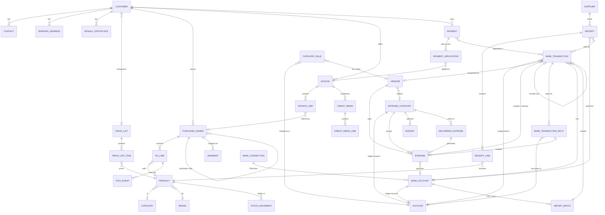

# SFL ERP System — Data Model

Wholesale sports card & collectibles distribution. All quantities flow through an immutable
**stock movement ledger**; money history is **snapshotted** so past documents never change;
and the **financial statements are rebuilt on demand** from these documents by a virtual
double-entry ledger (`accounting/ledger.py`) — nothing is posted, so nothing can drift.

## How the pieces connect

## Core (app: `core`)

| Model | Purpose | Key fields |
|---|---|---|
| **CompanySettings** | Singleton, edited on the Settings screen | company name, PNG logo, address, phone, email, website, points of contact, default tax rate, invoice template (modern/classic), invoice footer, alert email, shipping API keys. **Accounting:** `fiscal_year_start_month`, `accounting_basis_default` (cash/accrual shown first), `books_start_date`, `mileage_rate`, `sales_tax_filing_frequency`. **Bank feed:** `plaid_client_id`, `plaid_secret`, `plaid_env` (sandbox/production), `bank_sync_enabled`, `expense_review_digest` (weekly email) |
| **Role / UserProfile** | Admin-editable module access matrix | modules list, `can_see_costs`, `is_admin_role`. System roles: Admin, Office, Warehouse, Fulfillment Manager, **Bookkeeper** (banking, expenses, accounting, reports, invoices, payments, customers; sees costs) |
| **NumberSequence** | Configurable sequential numbering | key (po / invoice / credit), prefix, next number, zero-padding. Claimed atomically (`SELECT … FOR UPDATE`) |
| **ActivityLog** | Global "who did what, when" | timestamp, user, action, model, object, JSON of changes |
| **SoftDeleteModel** | Abstract base for every business model | `is_deleted`, `deleted_at`, `deleted_by` — nothing is ever hard-deleted |

Modules gated by roles now include `expenses`, `banking` (landing: review inbox) and
`accounting` (landing: Accounting home). Views that reveal costs or profit also require
`can_see_costs`.

## Inventory (app: `inventory`)

| Model | Purpose | Key fields |
|---|---|---|
| **Product** | One SKU | sku, name, description, category, brand, UPC (scan target, may differ from SKU), case pack, unit of measure, **avg_cost** (weighted average landed, 4 decimals), default wholesale price, MSRP, reorder point, bin location, image, active. `qty_on_hand` is a cache maintained transactionally with the ledger |
| **StockMovement** | ⭐ Immutable ledger — the source of truth | type (receipt / sale / adjustment / cycle count / credit restock / revalue), qty delta, **qty before/after**, unit cost, **avg cost after**, user, timestamp, reference to source document. Point-in-time valuation reads this table; the accrual ledger books inventory and COGS from it |
| **Receipt / ReceiptLine** | Supplier receiving **and the supplier bill** | supplier, date, freight + duties allocated proportionally to merchandise value → **landed unit cost** per line; posting rolls the weighted average cost. **Bill fields (4.0):** `supplier_invoice_number`, `due_date`, `paid_date`, `paid_from` (BankAccount), `payment_reference`; computed `amount_paid` (from linked bank transactions, else the whole bill when a paid date is typed), `balance_due`, `is_paid`, `is_overdue`. Shown as the **Supplier bill** card on the Receiving document; Receiving → *Unpaid bills* filters to open bills. A posted receipt is accounts payable on the accrual books until paid; a payment linked before posting is a **prepayment** (asset *Supplier deposits & prepayments*, judged per supplier) |
| **StockAdjustment** | Manual +/- with required reason | reasons: opening, received, damaged, shrinkage, sample, correction, personal use; linked 1-to-1 to its ledger row. Reasons map to ledger accounts (opening → opening balance equity, personal → owner draws, received → AP, others → inventory adjustments) |
| **CycleCount / CycleCountLine** | Count mode | snapshot qty vs counted qty → system generates the adjustment deltas |
| **PriceList / PriceListItem** | Per-SKU customer pricing | explicit price per (list, product); customer assigned to a list |
| **Category, Brand, Supplier** | Lookups | — |

**Quantity math:** on-hand comes from the ledger; committed = Σ open PO lines (Confirmed/Picking/Picked); available = on-hand − committed. Low stock = available ≤ reorder point.

## Customers (app: `customers`)

| Model | Purpose | Key fields |
|---|---|---|
| **Customer** | The retail store / reseller | business name, phone, email, billing address, payment terms (due-on-receipt … net-60), credit limit, **price list**, fallback discount %, **no-certificate policy** (charge tax OR block finalization — per customer), notes, active |
| **Contact** | Multiple named contacts | name, email, phone, role, primary flag |
| **ShippingAddress** | Multiple saved ship-tos | label, address, default flag |
| **ResaleCertificate** | Tax exemption docs | uploaded PDF/image, number, issuing state, issue + expiration dates. Status: valid / expiring (≤30 days) / expired / none — drives dashboard warnings and order flags |

**Pricing resolution for a PO line:** price-list price for that SKU → else default wholesale price minus customer discount % → always editable on the line.

## Orders (app: `orders`) — customer POs

| Model | Purpose | Key fields |
|---|---|---|
| **PurchaseOrder** | Order a customer places with you | number (sequential), customer, status, priority, ship-to, customer's own PO ref, order discount %, **☑ charge shipping + amount**, **☑ charge tax + rate**, notes, parent (backorder chain), full status timestamps |
| **POLine** | One SKU on the order | product, qty ordered, unit price (defaulted from price list, editable), line discount %, qty picked, short reason/note, backordered qty, **cost_snapshot** (weighted avg cost frozen at finalization — later cost changes never rewrite profit history) |
| **PickEvent** | Every scan/tap while picking | line, action (scan / manual ± / short), qty, barcode, user, timestamp |

**Status machine:** Draft → Confirmed → Picking → Picked → Finalized → Invoiced → Shipped/Delivered (+ Cancelled).
Confirm **commits** inventory (available ↓). Finalize **decrements on-hand** through the ledger and snapshots cost (accrual: Dr COGS / Cr Inventory). Cancel releases commitments. Shortfalls split into a **backorder child PO**.

## Invoicing (app: `invoicing`)

| Model | Purpose | Key fields |
|---|---|---|
| **Invoice** | From one PO or several finalized POs of one customer (consolidated; lines keep their PO reference) | number, dates, terms, bill-to/ship-to **text snapshots**, stored subtotal/shipping/tax/total, tax rate + **manual tax override flag**, status (open / partial / paid / void), emailed timestamp, `is_ar_adjustment` (opening-balance transfers: AR but not revenue) |
| **InvoiceLine** | Line with PO group reference | product, description, qty, price, discount, cost snapshot (COGS basis), category for manual lines |
| **CreditMemo / CreditMemoLine** | Returns / credits against an invoice | per-line **restock toggle** (returns units through the ledger), reduces customer balance |

**Tax:** valid resale cert → 0%. Otherwise the Settings default rate (or PO rate), and the amount itself can be overridden on any single invoice. Accrual ledger: invoice = Dr AR / Cr Sales + Shipping income + Sales tax payable.

## Payments (app: `payments`)

| Model | Purpose | Key fields |
|---|---|---|
| **Payment** | Money received | customer, date, amount, method (check/wire/ACH/Zelle/card/cash), reference #. Reverse M2M `deposits` → the bank transaction(s) it was deposited in |
| **PaymentApplication** | Split of one payment across invoices | payment, invoice, amount — supports partial payments and one check covering many invoices |

**Customer balance** = Σ invoice totals − Σ applications − Σ applied credits. AR aging buckets computed from invoice due dates. Ledger: payment = Dr Undeposited funds; a matched deposit moves it to the bank account.

## Expenses (app: `expenses`) — upgraded in 4.0

| Model | Purpose | Key fields |
|---|---|---|
| **ExpenseCategory** | One category = **one ledger account** (auto-created, kept in sync by name) | name, description, `account` (OneToOne accounting.Account, type expense), `tax_line` (Schedule C line for the year-end package), `deductible_pct` (meals 50), `monthly_budget` |
| **Vendor** | Who you pay; lets the bank feed recognise merchants | name, `default_category`, `aliases` (one per line, how it appears on statements), `is_1099` + `tax_id_last4` (1099-NEC list), email/phone/website, account #, notes, active. `matches(text)`, `find_for_description()`, `total_paid(start, end)` |
| **Expense** | The register row | `date` (incurred / bill date), category, vendor text + `vendor_link`, amount (negative = refund), note, `reference` (vendor invoice #), `receipt_file`. **Payment tracking:** `due_date`, `paid_date` (blank = unpaid bill), `paid_from` (BankAccount; blank + "paid personally" = owner contribution), `payment_method` (card/ach/check/cash/personal/other). `source` (manual / bank / recurring / import / quick), `recurring` (template), `is_reviewed` (False for auto-created rows). Properties: `is_paid` (paid date **or** a linked bank transaction), `effective_paid_date`, `is_overdue`, `has_receipt`, `paid_personally`, `bank_transaction`; `mark_paid()` |
| **RecurringExpense** | Template that spawns expenses on a schedule | name, vendor, category, amount, frequency (weekly / 2 weeks / monthly / quarterly / yearly), `next_date`, `end_date`, `paid_from`, `auto_mark_paid` (auto-pay vs open bill), note, active, `last_generated`, **`anchor_day`** (day of month the schedule is anchored to, set from the first `next_date`: Jan 31 → Feb 28 → Mar 31, never drifting to the 28th). `generate_due()` is run daily by `expenses.tasks.generate_recurring_expenses` |
| **Budget** | Planned spend per category per month (month null = whole year) | category, year, month, amount — unique per (category, year, month) |
| **MileageEntry** | Business miles (deliveries, shows, supplier pickups) | date, miles, purpose, from/to, round trip, `rate` snapshotted from Settings, vehicle. `deduction` = total miles × rate; not a cash movement, used by the year-end package |

Ledger: an expense is Dr its category / Cr AP on `date` (accrual) and Dr category / Cr the paying account on `paid_date` (cash). An expense created from a bank transaction (directly, or as one part of a split through `bank_split`) is carried by that transaction, never double counted. The 1099 report threshold is $600 through tax year 2025 and $2,000 from tax year 2026 (the report's threshold box defaults per year).

## Banking (app: `banking`) — new in 4.0

| Model | Purpose | Key fields |
|---|---|---|
| **BankConnection** | One login at one institution (a Plaid *Item*); several accounts hang off it | provider (plaid / manual), institution name + id, `item_id`, `access_token` (never shown), `sync_cursor`, status (active / error / relink / disconnected), `last_synced_at`, `last_error` |
| **BankAccount** | A checking, savings, credit card, cash drawer, loan or payment-processor account | name, institution, type, last 4, currency, connection, `external_account_id`, **`opening_balance`** (cards: amount owed, positive) + **`opening_date`** (transactions before it are not imported), `ledger_account` (OneToOne accounting.Account, auto-created: asset *bank* or liability *credit card / loan*), `is_default` (pre-selected "paid from"), active, notes. `balance_as_of(day)` / `current_balance` = opening ± posted, non-ignored transactions in the account's natural sign; `unreviewed_count` |
| **ImportBatch** | One CSV upload or sync run | account, source (csv / plaid / manual), file, filename, preset, row counts (total / imported / duplicate / skipped / auto-categorized), date range |
| **BankTransaction** | One line on a statement. Sign convention: **+ into the account, − out of it** | account, date, posted date, amount, description, original description, merchant, check #, `external_id` (Plaid, unique per account), `fingerprint` (sha1 of account·date·amount·normalized description, for CSV de-dupe), pending, source (csv / plaid / manual — only **manual** rows may be edited or deleted), batch. **Review outcome:** `status` (unreviewed / categorized / matched / transfer / ignored), `category_account`, vendor, `expense` (OneToOne — created from or matched to), `payments` (M2M — a deposit of customer payments), `receipts` (M2M — supplier bills paid, or refunded), `transfer_peer` (OneToOne self), `splits` (see below), `rule_applied`, `auto_categorized`, `suggested_account`, notes, receipt file (counts as the receipt for the expense it created), reviewed by/at |
| **BankTransactionSplit** | One slice of a transaction split across categories | transaction, `account` (where this part goes), `amount` (positive share; parts add up to the transaction), note, `expense` (OneToOne — the Expense row created for an expense-category part, reached from the expense as `bank_split`) |
| **CategoryRule** | "When a transaction looks like X, it is Y" | name, priority, active, match field (description / merchant / either), match type (contains / starts with / exact / regex), pattern, direction (in / out / any), account filter, amount min/max, action (categorize / ignore / transfer), `category_account`, vendor, `auto_confirm` (apply vs. only suggest), `times_applied`, `last_applied_at`. Regex patterns go through `banking/regex_guard.py`: nested quantifiers (`(a+)+`) and patterns over 200 characters are refused, and a saved pattern is time-boxed against a worst-case string |

**Review actions** (the only way status changes): `categorize(account)` — for an expense-category account also creates/updates the `Expense` row (an inflow makes a negative, refund, row); `link_expense(expense)` — marks it paid from this account; `link_payments(payments)`; `link_receipts(receipts)` — sets the receipts' paid date / paid-from; `split(parts)` — one `BankTransactionSplit` per part, an `Expense` per expense-category part; `mark_transfer(peer)` — pairs opposite-sign rows in two accounts; `mark_ignored()`; `reset_review()` — back to the inbox. Every action first calls `_release_documents()`, which undoes the previous decision completely: clears the paid date/paid-from this transaction wrote on receipts and unlinks them, unlinks payments, sends the transfer twin back to review, deletes split parts (and the bank-created expenses behind them) and retires the auto-created expense row — so changing a decision never books anything twice. UI: inbox buttons **Save / Match / Transfer / Personal / Ignore / Undo** and the checkbox **Always categorize like this**; transaction page buttons **Link** (payments, receipts, expenses), **Pair** (transfer twin), **Split**, **Record a customer payment for this deposit** (pre-fills the payment form), **Undo review**.

**Ignored** rows count toward nothing (not even the account balance); **pending** rows are shown but not booked.

## Accounting (app: `accounting`) — new in 4.0

| Model | Purpose | Key fields |
|---|---|---|
| **Account** | One row of the chart of accounts | code (sort), name, type (asset / liability / equity / income / cogs / expense), subtype (bank, credit card, AR, inventory, supplier deposits, AP suppliers, AP carriers, sales tax, customer deposits, loan, opening balance, owner contribution, owner draw, retained, sales, shipping income, returns, other income, **uncategorized income**, COGS, inventory purchases, inventory adjustments, shipping expense, expense, **uncategorized expense**…), description, `system_key` (set on the 25 accounts the engine relies on; `Account.system(key)` creates lazily), `is_system`, active. System accounts carry plain-English names, e.g. `undeposited` = *Payments received, not yet deposited*, `opening_balance` = *Starting balances (opening balance equity)*, `customer_deposits` = *Customer payments not yet applied*; `setup_accounts` refreshes the names. `signed_balance()` turns raw debits−credits into the natural sign. `bank_category_choices()` feeds the review dropdown (expense categories first, then income / inventory / owner accounts) |
| **FiscalPeriodLock** | Soft close | `locked_through` date, note. The UI warns when a document inside a closed period is edited; admins can override |
| **MonthClose** | One month's closing checklist (Accounting → Month close, `/accounting/month-close/?month=YYYY-MM`) | `year`, `month` (unique together), `steps` (JSON: manual step key → done), `notes`, `closed_at`, `closed_by`, `updated_at`. Automatic steps are computed live; `accounting.closing.dashboard_tile()` returns `{label, year, month, done, total, is_closed, url}` for the previous month, which the dashboard shows as "September: 4 of 6 done" |

There is **no journal table**. `accounting/ledger.py` builds `Journal(basis, checkpoints)` from the documents above each time a statement is requested (see `docs/ACCOUNTING.md` for the entry rules). Bases: `cash` and `accrual`. Supplier AP lines are tagged with the supplier so the period-end true-up can reclassify a debit balance to *Supplier deposits & prepayments* **per supplier**; `compare_bases()` returns the bridge with plain-English labels (*Invoiced but not yet collected*, *Paid to suppliers ahead of delivery*, …).

## Shipping (app: `shipping`)

**Shipment**: PO, provider (ShipStation / Shippo / uShip / Pirate Ship / local / manual), service, weight/dims, tracking number, label or freight cost, ship date, external reference, sync + "tracking emailed" timestamps, delivery proof. Carrier logic lives behind a common `ShippingProvider` interface. Accrual ledger: a shipment cost is Dr Shipping labels & freight / Cr AP — carriers; the card charge for the label clears it.

## Where your key questions are answered

- **"Why is this SKU at this number?"** → `StockMovement` rows for that product: every receipt, sale, adjustment, count and restock with before/after, user, timestamp, and the source document.
- **Month-end inventory value as of any date** → replay the ledger to that date; each row carries the weighted average cost after it, so valuation is exact, not an estimate. The accrual balance sheet is trued up to this number at every period end.
- **Profit** → invoice/PO lines carry the cost snapshot taken at finalization; profit = (price − snapshot) × qty, immune to later cost changes. Shipping label costs and overhead expenses subtract on the P&L.
- **"Where did that card charge go?"** → `BankTransaction.category_account` (or the linked expense / receipts / payments / transfer twin / split parts), who reviewed it, which rule applied, and the general ledger line it produced.
- **"Am I building equity?"** → the accrual balance sheet's equity at each month end (Accounting → Equity trend); on the dashboard as the change since last month-end.
