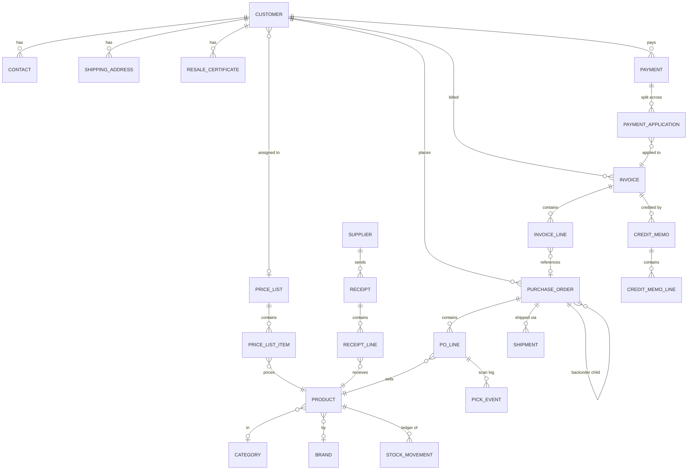

# SFL ERP System — Data Model

Wholesale sports card & collectibles distribution. All quantities flow through an immutable
**stock movement ledger**; money history is **snapshotted** so past documents never change.

## How the pieces connect

## Core (app: `core`)

| Model | Purpose | Key fields |
|---|---|---|
| **CompanySettings** | Singleton, edited on the Settings screen | company name, PNG logo, address, phone, email, website, points of contact, default tax rate, invoice template (modern/classic), invoice footer, alert email |
| **NumberSequence** | Configurable sequential numbering | key (po / invoice / credit), prefix, next number, zero-padding. Claimed atomically (`SELECT … FOR UPDATE`) |
| **ActivityLog** | Global "who did what, when" | timestamp, user, action, model, object, JSON of changes |
| **SoftDeleteModel** | Abstract base for every business model | `is_deleted`, `deleted_at`, `deleted_by` — nothing is ever hard-deleted |

## Inventory (app: `inventory`)

| Model | Purpose | Key fields |
|---|---|---|
| **Product** | One SKU | sku, name, description, category, brand, UPC (scan target, may differ from SKU), case pack, unit of measure, **avg_cost** (weighted average landed, 4 decimals), default wholesale price, MSRP, reorder point, bin location, image, active. `qty_on_hand` is a cache maintained transactionally with the ledger |
| **StockMovement** | ⭐ Immutable ledger — the source of truth | type (receipt / sale / adjustment / cycle count / credit restock), qty delta, **qty before/after**, unit cost, **avg cost after**, user, timestamp, reference to source document. Point-in-time valuation reads this table |
| **Receipt / ReceiptLine** | Supplier receiving | supplier, date, freight + duties allocated proportionally to merchandise value → **landed unit cost** per line; posting rolls the weighted average cost |
| **StockAdjustment** | Manual +/- with required reason | reasons: received, damaged, shrinkage, sample, correction, personal use; linked 1-to-1 to its ledger row |
| **CycleCount / CycleCountLine** | Count mode | snapshot qty vs counted qty → system generates the adjustment deltas |
| **PriceList / PriceListItem** | Per-SKU customer pricing | explicit price per (list, product); customer assigned to a list |
| **Category, Brand, Supplier** | Lookups | — |

**Quantity math:** on-hand comes from the ledger; committed = Σ open PO lines (Confirmed/Picking/Picked); available = on-hand − committed. Low stock = available ≤ reorder point.

## Customers (app: `customers`)

| Model | Purpose | Key fields |
|---|---|---|
| **Customer** | The retail store / reseller | business name, phone, email, billing address, payment terms (due-on-receipt … net-60), credit limit, **price list**, fallback discount %, **no-certificate policy** (charge tax OR block finalization — per customer, as you asked), notes, active |
| **Contact** | Multiple named contacts | name, email, phone, role, primary flag |
| **ShippingAddress** | Multiple saved ship-tos | label, address, default flag |
| **ResaleCertificate** | Tax exemption docs | uploaded PDF/image, number, issuing state, issue + expiration dates. Status: valid / expiring (≤30 days) / expired / none — drives dashboard warnings and order flags |

**Pricing resolution for a PO line:** price-list price for that SKU → else default wholesale price minus customer discount % → always editable on the line.

## Orders (app: `orders`) — customer POs

| Model | Purpose | Key fields |
|---|---|---|
| **PurchaseOrder** | Order a customer places with you | number (sequential), customer, status, priority, ship-to, customer's own PO ref, order discount %, **☑ charge shipping + amount**, **☑ charge tax + rate**, notes, parent (backorder chain), full status timestamps |
| **POLine** | One SKU on the order | product, qty ordered, unit price (defaulted from price list, editable), line discount %, qty picked, short reason/note, backordered qty, **cost_snapshot** (weighted avg cost frozen at finalization — later cost changes never rewrite profit history) |
| **PickEvent** | Every scan/tap while picking | line, action (scan / manual ± / short), qty, barcode, user, timestamp |

**Status machine:** Draft → Confirmed → Picking → Picked → Finalized → Invoiced → Shipped/Delivered (+ Cancelled).
Confirm **commits** inventory (available ↓). Finalize **decrements on-hand** through the ledger and snapshots cost. Cancel releases commitments. Shortfalls split into a **backorder child PO**.

## Invoicing (app: `invoicing`)

| Model | Purpose | Key fields |
|---|---|---|
| **Invoice** | From one PO or several finalized POs of one customer (consolidated; lines keep their PO reference) | number, dates, terms, bill-to/ship-to **text snapshots**, stored subtotal/shipping/tax/total, tax rate + **manual tax override flag**, status (open / partial / paid / void), emailed timestamp |
| **InvoiceLine** | Line with PO group reference | product, description, qty, price, discount, cost snapshot (COGS basis) |
| **CreditMemo / CreditMemoLine** | Returns / credits against an invoice | per-line **restock toggle** (returns units through the ledger), reduces customer balance |

**Tax:** valid resale cert → 0%. Otherwise the Settings default rate (or PO rate), and the amount itself can be overridden on any single invoice.

## Payments (app: `payments`)

| Model | Purpose | Key fields |
|---|---|---|
| **Payment** | Money received | customer, date, amount, method (check/wire/ACH/Zelle/card/cash), reference # |
| **PaymentApplication** | Split of one payment across invoices | payment, invoice, amount — supports partial payments and one check covering many invoices |

**Customer balance** = Σ invoice totals − Σ applications − Σ applied credits. AR aging buckets computed from invoice due dates.

## Expenses (app: `expenses`)

**ExpenseCategory**, **Expense** (date, category, vendor, amount, note, optional receipt file) — feeds the monthly P&L.

## Shipping (app: `shipping`)

**Shipment**: PO, provider (ShipStation / uShip / Pirate Ship / manual), service, weight/dims, tracking number, label or freight cost, ship date, external reference, sync + "tracking emailed" timestamps. Carrier logic lives behind a common `ShippingProvider` interface — ShipStation full REST, uShip API-or-manual adapter, Pirate Ship CSV batch export + paste-back (no fake API).

## Where your key questions are answered

- **"Why is this SKU at this number?"** → `StockMovement` rows for that product: every receipt, sale, adjustment, count and restock with before/after, user, timestamp, and the source document.
- **Month-end inventory value as of any date** → replay the ledger to that date; each row carries the weighted average cost after it, so valuation is exact, not an estimate.
- **Profit** → invoice/PO lines carry the cost snapshot taken at finalization; profit = (price − snapshot) × qty, immune to later cost changes. Shipping label costs and overhead expenses subtract on the P&L.
